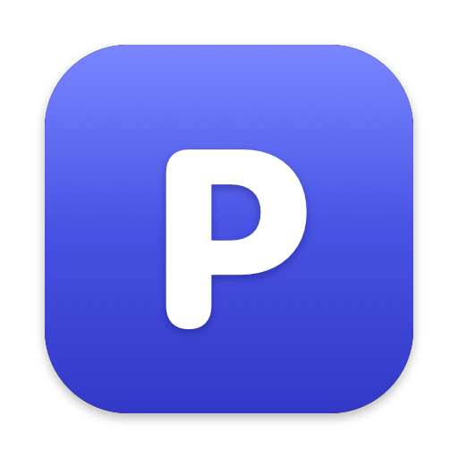
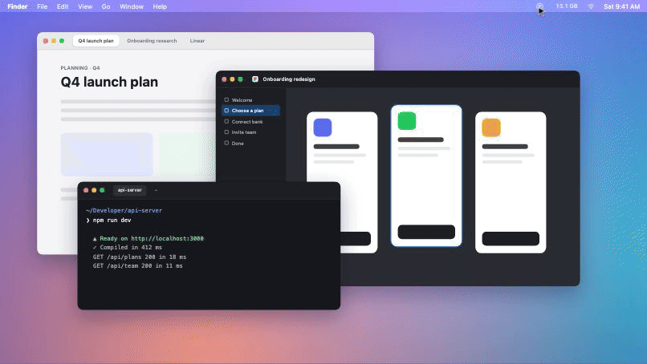
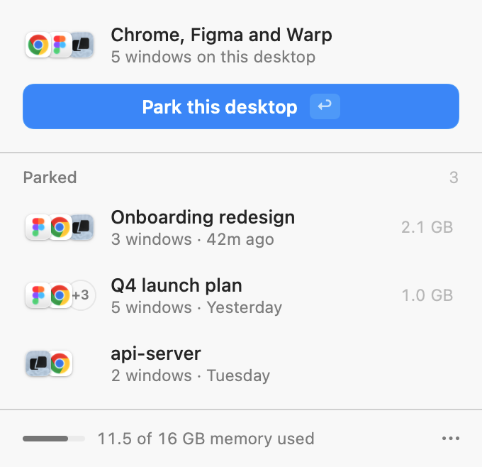
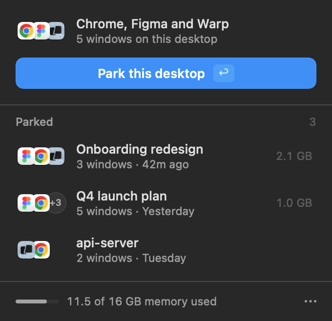

<p align="center">
  
</p>

<h1 align="center">Park</h1>

<p align="center"><strong>Park a desktop. Get your memory back. Pick up exactly where you left off.</strong></p>

<p align="center"><a href="https://parkformac.com">parkformac.com</a></p>

<p align="center">
  
  <br>
  <a href="docs/demo.mp4">Watch the full demo (MP4)</a>
</p>

Park is a tiny macOS menu bar app for people who keep one project per desktop (Space). When you're done with a project for now, park its desktop: Park remembers every window on it, closes them, and quits apps you weren't using anywhere else. When you come back, one click reopens it all, with the same tabs, files, folders and window positions.

No setup, no presets, no config files.

<p align="center">
  
  &nbsp;&nbsp;
  
</p>

## How it works

1. Go to the desktop you want to put away.
2. Press **⌃⌥P** (or click the Ⓟ icon in the menu bar) and choose **Park this desktop**. You can also press **⌃⌥⌘P** to park right away without opening the panel.
3. Later, switch to any desktop, open Park, and click the parked item. Its windows reopen there.

Each parked desktop shows how much memory parking it freed. The panel's footer shows overall memory use, so you can tell when it's time to park something.

## What comes back

| App | Restored |
| --- | --- |
| **Chrome, Brave, Edge, Vivaldi, Chromium** | Every tab, in order, with the active tab and window position. Incognito windows stay open, so their tabs are never written to disk |
| **Figma** (desktop app) | Every file tab, including the page, selection and zoom you were on |
| **Warp** | Every tab and split pane in its working directory. Commands that were running are recorded but not re-run |
| **Finder** | The folder each window showed |
| **Document apps** (Preview, TextEdit, Pages, Office…) | The open file, in the same app and position |
| **Everything else** | The app itself. Most apps (Slack, Notion, Linear…) restore their own state when relaunched |
| **Safari, Firefox, Terminal, iTerm** | Not yet: their windows stay open |

Apps whose windows were all on the parked desktop are quit, which frees the most memory. Apps you also use on other desktops just have that desktop's windows closed. A few companions stay running regardless: Finder, Slack, Messages, Mail, Calendar, Spotify, Music and Warp. You can turn quitting off in the ··· menu.

**Park never closes a window it can't bring back.** A window stays open, and the panel tells you why, when:

- Park can't read it exactly: a missing permission, an incognito window, an unsaved local Figma file, or two same-sized Warp or Figma windows it can't tell apart.
- it belongs to an app Park doesn't support tab by tab yet (Safari, Firefox, Terminal, iTerm).
- it has nothing app-specific to save, and its app stays running because it's also in use on another desktop.

Park also records everything before it closes anything, so a crash mid-park can't lose windows (the next launch recovers them), and it warns you before you park a terminal that's running something. After a restore, **Put back** returns the item to your list for ten minutes, in case something didn't come back the way you wanted.

## Install

Requires macOS 14 or later.

```bash
git clone https://github.com/spencerceverett-maker/park.git
cd park
./scripts/build.sh --install   # builds Park.app and installs it to ~/Applications
```

The build only needs Apple's Command Line Tools (`xcode-select --install`); you don't need Xcode.

Park adds itself to your login items on first launch, so it's always there after a restart (switch **Open at Login** off in the ··· menu if you'd rather not). On first launch it also asks for **Accessibility** access, which it uses to find, close and place windows. The first time it parks Chrome or Finder, macOS asks once more to let Park control them. Everything stays on your Mac: Park saves parked desktops as JSON in `~/Library/Application Support/Park/`.

**Code signing:** unsigned (ad hoc) builds lose the Accessibility permission each time you rebuild. To avoid that, sign with any certificate in your keychain (`security find-identity -p codesigning`), either by exporting `PARK_SIGN_IDENTITY` or by putting it in `scripts/signing.local`:

```bash
echo 'PARK_SIGN_IDENTITY="Apple Development: you@example.com (TEAMID)"' > scripts/signing.local
```

## How it's built

A SwiftUI panel in a borderless `NSPanel`, plus a small engine:

- **Finding windows on the current desktop:** `CGWindowList` and the Accessibility API, plus a few long-standing private CoreGraphics/SkyLight calls (the same ones AltTab, yabai and Hammerspoon use) to tell which Space each window is on. They're looked up at runtime, so if a future macOS removes one, Park falls back to a conservative mode (it never quits apps) instead of failing to launch. This also means Park can't ship on the Mac App Store.
- **Browsers:** AppleScript, with every value passed as typed arguments, never pasted into script text.
- **Figma:** reads the open windows and tabs from Figma's own `settings.json` and reopens files with `figma://` links.
- **Warp:** reads tabs, splits and directories from Warp's state database (read-only) and restores them through a temporary Warp launch configuration.
- **Memory:** process footprints, measured the same way Activity Monitor does, before and after parking.

```
Sources/Park/
  App/      app lifecycle, menu bar panel, hotkeys, model
  Engine/   window discovery, per-app capture/close/restore
  Model/    parked desktops and their persistence
  UI/       SwiftUI views and design tokens
```

Tests cover naming, persistence (including corrupt and future-format data) and the app-specific formats:

```bash
swift test
```

To check the engine without touching your real windows:

```bash
build/Park.app/Contents/MacOS/Park --dry-run     # print what parking this desktop would save
build/Park.app/Contents/MacOS/Park --self-test   # open throwaway windows, park and restore only those
```

## Known limits

- Windows reopen on whichever desktop you're on when you restore. Park doesn't recreate desktops. If a window was on a monitor that's no longer connected, it's moved onto your main screen.
- Browser tabs reload, so their back history, scroll position and form contents are gone. Tab groups and pinned tabs aren't scriptable, so those aren't restored.
- Chrome windows reopen in Chrome's most recently used profile, which may not be the one they were parked from.
- Warp stops processes in closed windows (dev servers, CLI sessions) about a minute after closing. Park reopens the directories but doesn't rerun commands, and it saves only the program's name (like `npm run dev`), never the full command line.
- Apps without specific support come back by relaunching. That relies on the app restoring its own windows, which most do, unless "Close windows when quitting an application" is turned on in System Settings → Desktop & Dock.
- Only the active display's desktop is parked.

## License

[MIT](LICENSE)
